# Weekly Update: A Froude-Grounded Latent Action World Model Across Bodies

Period: 2026-09-20 to 2026-09-30

## The problem this period set out to fix

To choose an action, the world model imagines the future for each candidate action and reads off the resulting motion. That only works if **different actions give different predicted futures**.

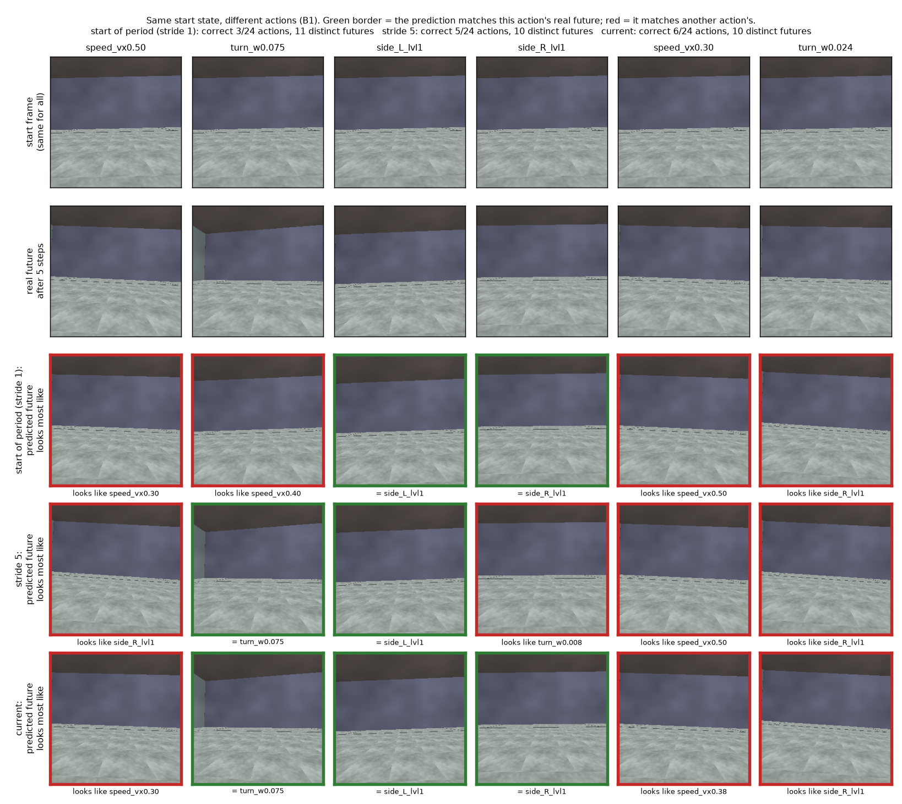

- **Row 1:** one start state.
- **Row 2:** the real future 5 steps later under 6 different actions.
- **Rows 3–5:** each model's prediction, shown as the real future it is closest to. Green = it matches the right action; red = it matches another action's future.

Metric: top-1 retrieval accuracy of the predicted future among the 24 actions' real futures (chance 0.042), averaged over all start states.

| model | top-1 retrieval accuracy |
|---|---|
| start of the period (one frame per step) | 0.161 |
| five frames per step | 0.233 |
| current pipeline (below) | 0.266 / 0.271 (seeds S0 / S1) |

**Bodies.**
- **Pretraining body:** hexapod c10f10t10.
- **Test bodies:**
  - c10 itself (same body);
  - hexapod c08f09t09, other leg lengths, zero-shot;
  - Unitree B1 quadruped, adapted.

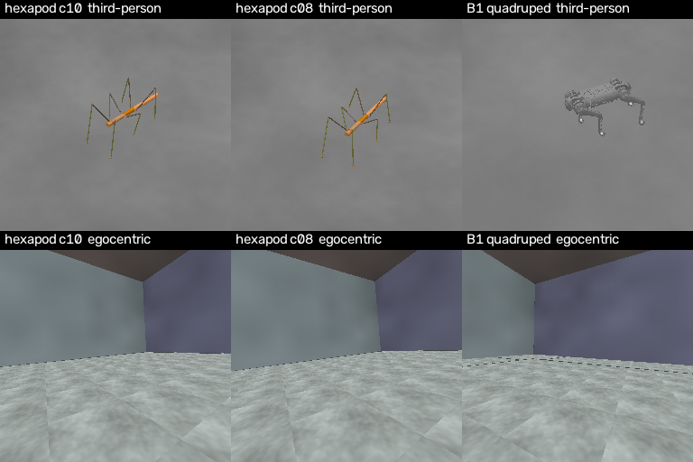

Clips: [forward](../results/deck/weekly/bodies_forward.mp4), [turn](../results/deck/weekly/bodies_turn.mp4), [sideways](../results/deck/weekly/bodies_sideways.mp4).

**Task:** a goal Froude sequence comes from a held-out hexapod clip. The test body selects one candidate per step from its own clip library.

---

## Metrics

Every table names the metric it uses.

| metric | definition | range / better |
|---|---|---|
| Error E | Mean Euclidean (L2) distance between achieved and goal Froude over decision steps | ≥ 0 / lower |
| Normalised score (NS) | (E_random − E) / (E_random − E_oracle), as the RL "human-normalised score". E_random: uniformly random candidate. E_oracle: hindsight oracle, the best candidate per step knowing the outcome | 0 = random, 1 = oracle / higher |
| Pearson r | Pearson correlation between read and true Froude across the 24 candidate actions from the same start state; per channel fwd / lat / yaw | −1 to 1 / higher |
| Top-1 retrieval accuracy | Per start state, subtract the mean over the 24 actions from the predicted and the real 5-step embedding change; correct if the cosine similarity is highest with the same action's real change | chance 0.042 / higher |
| Body-ID probe accuracy | Logistic regression z → body identity, 5-fold CV grouped by clip, classes balanced | chance 0.33 (3 bodies) / lower = more shared |
| Cross-body R² | Ridge regression z → Froude fit on c10 only, evaluated on another body; < 0 = worse than that body's mean | ≤ 1 / higher = more shared |
| k-NN mixing ratio (k = 10) | Share of each point's 10 nearest neighbours (standardised z) from another body, divided by its value under random mixing | 0 = separated, 1 = mixed |
| Cross-body retrieval | For each c10 transition, the nearest neighbour in standardised z among another body's transitions: 1 − L2(Froude, neighbour's Froude) / mean L2(Froude, random transition of that body) | 0 = random, 1 = identical motion / higher |

- **Froude:** with hip height h and gravity g, forward and lateral speed in the body frame are divided by √(g·h), and yaw rate is multiplied by √(h/g).
- **Normalised-score bounds (oracle / random error):** B1 0.034 / 0.127 (library of 23 clips); c08 0.020 / 0.121; c10 0.0135 / 0.1535.

---

## 1. The pipeline

| part | design | shared or per body |
|---|---|---|
| encoder | frozen V-JEPA2, egocentric camera | shared |
| rendering | every body's room, floor and floor texture scaled with its camera height; rendered from the same camera poses, the hexapod and B1 scenes are indistinguishable to a frame-level body-identity probe (0.552, chance 0.5) | — |
| latent action | z = ITM(e_t, e_t+5): five frames per step, driven by a 5-command chunk, as in LAC-WM | shared |
| forward model | FTM predicts e_t+5 from (e_t, z) | shared |
| motion target that trains z | **Froude head: input z only (no frame), one head for all bodies, its gradient trains z**; the task-space counterpart of LAC-WM's end-effector / camera motion target | shared |
| other training losses | reconstruction; separation between real-z and null-z predictions; frozen read-out; 2-step rollout consistency | shared |
| action projector | the body's commands → z | **per body (the only per-body part)** |
| adaptation | Body in joint pretraining: fit its projector (Stage 2). Unseen body: LoRA on ITM/FTM (Stage 1) with the pretraining losses, then fit its projector. | shared head; per-body projector |

**Two selection mechanisms**

| mechanism | score of candidate a (L2 to the goal) | uses the current state |
|---|---|---|
| direct | Froude head(proj(a)) | no |
| rollout | Froude head(ITM(e_t, FTM(e_t, proj(a)))) | yes |

Rollout starting observation:
- **candidate's recorded frame:** the frame saved with that candidate action in its original clip. This is an offline replay comparison.
- **robot's actual current frame:** the observation at the decision point, shared by all candidate actions. This is the state a live selector must plan from.

Read-out window: 11 steps.

---

## 2. Adapting a body that was not in pretraining

**Now**

| stage | what is trained | data |
|---|---|---|
| 1 | LoRA on the ITM / FTM MLP layers, everything else frozen, with the pretraining losses (reconstruction, separation, Froude loss through the frozen Froude head) | a few clips of the new body |
| 2 | the new body's action projector (commands → z) | the new body's clips |

**Before**

| stage | what is trained | data |
|---|---|---|
| 1 | all ITM / FTM weights, with reconstruction and separation losses | a few clips of the new body |
| 2 | the new body's action projector (commands → z) | the new body's clips |
| 4 | the shared Froude head, refit | the new body's clips + hexapod clips, so the hexapod is still read |

**LoRA instead of updating all weights.** Updating all ITM / FTM weights makes the model forget the hexapod; LoRA adds a small low-rank change on top of the frozen weights. Metric: rollout error relative to always predicting the average z (lower is better, 1.0 = no better than the average).

| Stage 1 | hexapod (already trained on) | B1 (new body) |
|---|---|---|
| all weights updated | 0.918 | 0.307 |
| LoRA rank 2 | 0.786 | 0.319 |

With LoRA, 3 clips of the new body are as good as 15 (rollout error: hexapod 0.764 vs 0.766, B1 0.315 vs 0.307).

**LoRA capacity.** Metric: normalised score on B1 selection (w=11): direct / rollout from the candidate's recorded frame / rollout from the robot's current frame.

| Stage 1 | B1 selection |
|---|---|
| LoRA rank 2, 1000 steps | +0.68 / +0.56 / +0.32 |
| LoRA rank 8, 3000 steps | **+0.87 / +0.66 / +0.41** |
| LoRA rank 8, 3000 steps, current B1 data, S0 / S1 | +0.83 / +0.39 / +0.39, +0.74 / +0.29 / +0.29 |

First two rows: earlier B1 data, S0. The old pipeline on the current data (S0): (re-measuring).

---

## 3. Motion target: Froude only, or Froude + per-body joint commands

The two versions are identical except for an extra motion decoder that predicts each body's joint commands (18-d hexapod, 12-d B1). Two seeds each. Metric: normalised score (0 = random, 1 = oracle).

| test | with joint-command decoder, S0 | with, S1 | **Froude only, S0** | **Froude only, S1** |
|---|---|---|---|---|
| c10 same body, direct | +0.91 | +0.90 | +0.91 | +0.91 |
| c10, rollout (candidate's recorded frame) | +0.72 | +0.73 | +0.74 | +0.76 |
| c10, rollout (robot's actual current frame) | +0.64 | +0.59 | +0.61 | +0.66 |
| c08 zero-shot, direct | +0.80 | +0.79 | +0.78 | +0.79 |
| c08, rollout (candidate's recorded frame) | +0.47 | +0.54 | +0.56 | +0.63 |
| c08, rollout (robot's actual current frame) | +0.52 | +0.43 | +0.53 | +0.54 |
| B1 adapted, direct | +0.80 | +0.85 | +0.83 | +0.74 |
| B1, rollout (candidate's recorded frame) | +0.54 | +0.34 | +0.39 | +0.29 |
| B1, rollout (robot's actual current frame) | +0.46 | +0.38 | +0.39 | +0.29 |

B1 rows: B1 adapted with the page 2 pipeline on the current rendering. c10 and c08 need no adaptation.

- The hexapods: equal, Froude only slightly ahead on c08 rollout from the recorded frame.
- The B1: equal on direct; the joint-command decoder is ahead on rollout by about 0.1 (recorded frame +0.34 to +0.54 vs +0.29 to +0.39; current frame +0.38 to +0.46 vs +0.29 to +0.39).
- The current pipeline uses Froude only (one fewer per-body part); on the B1's rollout it costs about 0.1.

---

## 4. Physics closed loop

- **B1:** the chosen candidate's command is executed by the B1's own walking policy in MuJoCo.
- **c08:** the candidate's joint commands drive the physics-simulated body in CoppeliaSim.

Decision every 2 steps, six goals, no B1 run fell. Hexapod-only models; B1 on the earlier rendering. Metric: error E, mean L2 between achieved and goal Froude (lower is better).

In physics, direct selection follows the goal; rollout is close to or worse than random on the B1 (0.081 / 0.108 vs random 0.089) and 3–4× direct's error on c08 for the same goals.

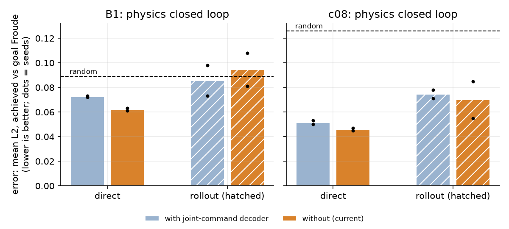

| version | B1 direct | B1 rollout | c08 direct | c08 rollout |
|---|---|---|---|---|
| with joint-command decoder, S0 / S1 | 0.072 / 0.073 | 0.073 / 0.098 | 0.053 / 0.050 | 0.071 / 0.078 |
| **Froude only (current), S0 / S1** | **0.061 / 0.063** | 0.081 / 0.108 | **0.047 / 0.045** | 0.085 / 0.055 |
| random candidate | 0.089 | 0.089 | 0.126 | 0.126 |

Same goals, direct vs rollout selection (S0; error = mean L2 between achieved and goal Froude, lower is better):

| goal | c08 direct | c08 rollout | B1 direct | B1 rollout |
|---|---|---|---|---|
| turn | 0.024 | 0.106 | 0.078 | 0.086 |
| forward | 0.041 | 0.141 | 0.068 | 0.081 |

**B1** (goal hexapod | B1 in physics, third-person | B1's egocentric input, with Froude traces)

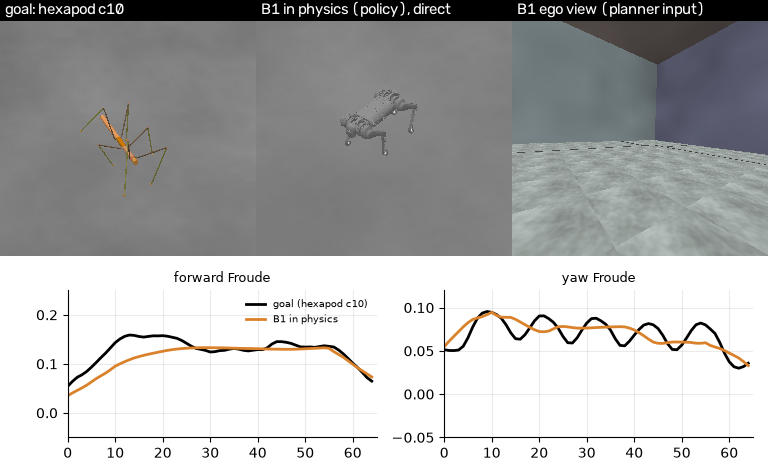
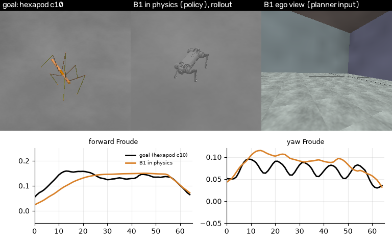

Direct: [turn](../results/deck/weekly/b1_physics_turn.mp4), [forward](../results/deck/weekly/b1_physics_forward.mp4). Rollout: [turn](../results/deck/weekly/b1_physics_turn_rollout.mp4), [forward](../results/deck/weekly/b1_physics_forward_rollout.mp4).

**c08** (goal hexapod third-person | its ego view | c08 in physics, with Froude traces)

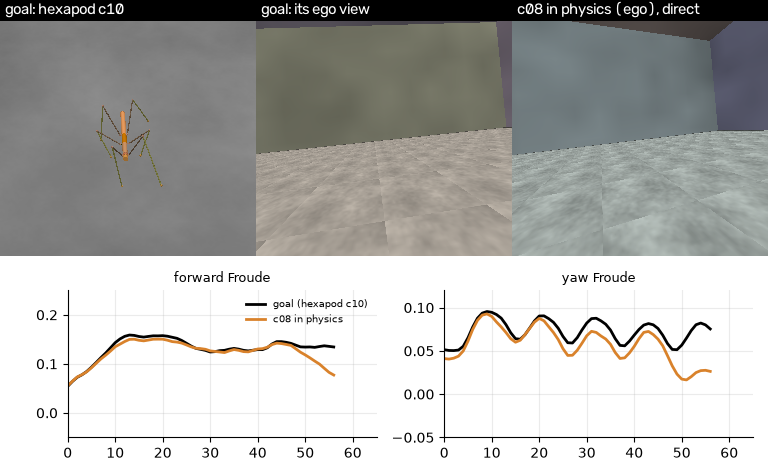
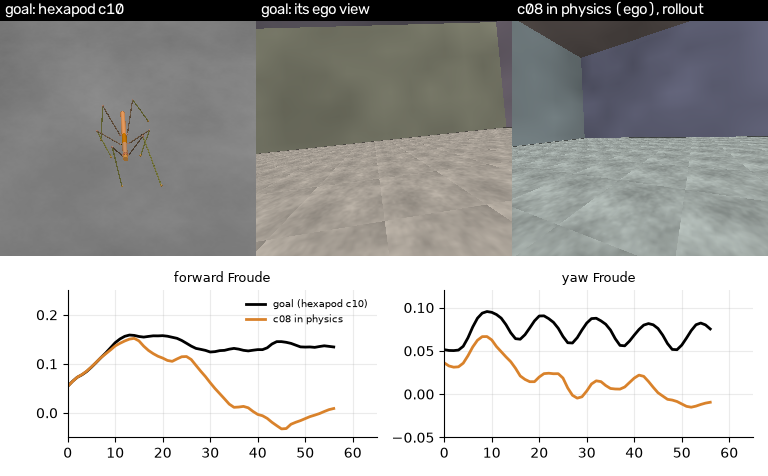

Direct: [turn](../results/deck/weekly/physics_turn.mp4), [forward](../results/deck/weekly/physics_forward.mp4). Rollout: [turn](../results/deck/weekly/physics_turn_rollout.mp4), [forward](../results/deck/weekly/physics_forward_rollout.mp4).

---

## 5. Trace the rollout failure: FTM → ITM → Froude head

**Follow one candidate action through the blocks.** Solid arrows show rollout; dashed arrows show the real-future control and the direct shortcut.

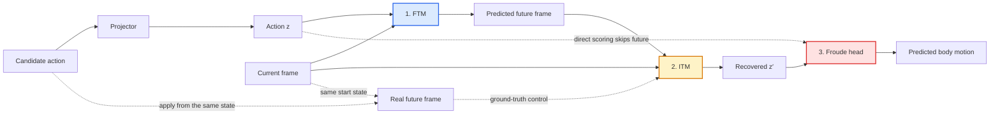

- **Selection gap on c10 (the pretraining body):** direct **+0.91**; rollout **+0.74–0.76** from each candidate's recorded frame, **+0.61–0.66** from the robot's actual current frame (normalised score, two seeds).
- **Test:** from one start state, apply each of the 24 candidate actions, render the real future, and read Froude at each point of the chain (24 start states per body).

| Froude reading (Pearson r, forward / lateral / yaw) | hexapod c10 (pretrained) | hexapod c08 (zero-shot) | B1 (adapted, page 2 pipeline) |
|---|---|---|---|
| direct from action | 0.99 / 0.92 / 0.98 | 0.98 / 0.80 / 0.95 | 0.88 / 0.79 / 0.78 |
| candidate's own recorded transition | 0.95 / 0.74 / 0.74 | 0.91 / 0.55 / 0.38 | 0.47 / 0.74 / 0.22 |
| **real** future from the same start state | 0.18 / 0.40 / 0.28 | 0.40 / 0.42 / 0.38 | 0.15 / 0.46 / 0.41 |
| **FTM-predicted** future from that state | 0.25 / 0.36 / 0.60 | 0.35 / 0.31 / 0.62 | 0.32 / 0.24 / 0.45 |

Mean of S0 / S1; 24 start states × 24 actions (c08: × 48). Futures rendered kinematically in each body's training scene; on the B1, futures executed by its walking policy in physics from a saved state give the same drop (0.12–0.19 / −0.43 to −0.10 / 0.45–0.54, earlier checkpoint).

- **Where the information is lost:** already at the real future. Even with a perfect FTM, the read of an alternative action from a shared start state is weak, on all three bodies, including the body the model was pretrained on.

**Is the motion still in z′, or is it the read-out?** Earlier B1 checkpoint (stride 5). A linear probe fitted on same-start alternative transitions, tested on held-out start states:

| read of z′ | real future | FTM-predicted future |
|---|---|---|
| model's Froude head (trained on one-action-per-clip pairs) | 0.24 / 0.52 / 0.24 | 0.10 / 0.23 / 0.21 |
| linear probe fitted on alternative transitions (one probe per column) | **0.58 / 0.60 / 0.56** | **0.48 / 0.63 / 0.72** |

| rollout selection, robot's current frame (w=11) | normalised score |
|---|---|
| model's Froude head | +0.40 |
| the probe (FTM-predicted fit) replacing the head | +0.33 |

**Conclusion.**
- z′ keeps decodable motion information (probe r ≈ 0.6 on held-out start states), but the Froude head, trained on one-action-per-clip transitions, does not generalise to same-start alternatives.
- Refitting the read-out alone on a small set of alternative transitions (8 start states, one room) did not improve selection (+0.40 → +0.33).
- The same failure occurs on the pretrained c10 body: a training-data problem, not specifically a cross-body one.
- Fixing it needs diverse alternative transitions across states and rooms, including multi-step imagined rollouts, during joint training of the ITM, FTM and Froude head (page 8).

---

## 6. Does z transfer across bodies?

The Froude head reads the same motion from c10, c08 and B1 only if their latents carry compatible meanings. We test this with a readout fitted on c10 and applied to the other bodies **without refitting**. Body-ID, mixing and retrieval test whether the wider 64-D space is shared too. Rollout selection remains the practical test.

| pretraining | body-ID probe | cross-body R² c10 → c08 | cross-body R² c10 → B1 | k-NN mixing | retrieval c10 → c08 | retrieval c10 → B1 |
|---|---|---|---|---|---|---|
| hexapod only (B1 not adapted) | (re-measuring) | | | | | |
| hexapod only, B1 adapted (page 2 pipeline; mean S0 / S1) | 0.68 | +0.70 / +0.34 / +0.17 | −0.73 / +0.11 / −0.04 | 0.47 | 0.38 | 0.25 (0.25 / 0.24) |
| joint, no similarity loss | 0.73 | +0.76 / +0.38 / +0.18 | −1.40 / −0.07 / −0.87 | 0.35 | 0.40 | 0.22 |
| joint + Froude-similarity loss | 0.73 | +0.71 / +0.30 / +0.04 | −1.59 / −0.09 / −1.06 | 0.36 | 0.44 | 0.24 |

Joint pretraining uses c10 + B1 (48 clips each, B1 on the current rendering). The similarity loss encourages transitions with similar Froude motion to have similar z.

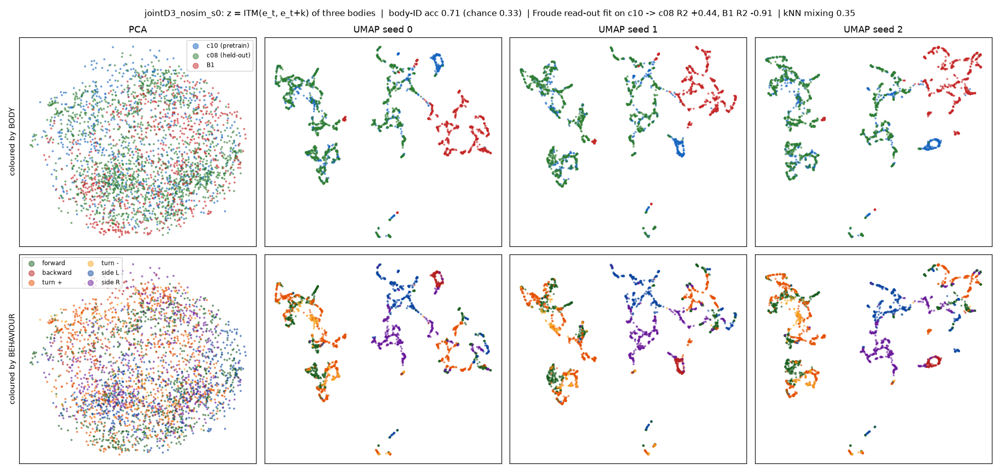

- z is shared between the two hexapods (c10 → c08 forward R² +0.71 to +0.76, retrieval 0.40–0.44).
- z is not shared with the B1 in any version: retrieval 0.22–0.25 (hexapods 0.38–0.44), forward R² negative. Joint pretraining and the similarity loss do not change this.

---

## 7. Selection when the B1 is in pretraining

Joint models are used as pretrained: only the B1's action projector is fitted. The joint models were pretrained before a B1 label correction (hard-turn clips); their projectors and all evaluation use the corrected data, and retraining is planned. The first column adapts the B1 to a hexapod-only model with the adaptation pipeline of page 2. Metric: normalised score (0 = random, 1 = oracle), w=11.

| test | hexapod-only pretraining; B1 adapted (S0 / S1) | joint, no similarity loss (S0) | joint + similarity loss (S0) |
|---|---|---|---|
| B1 direct | +0.83 / +0.74 | +0.92 | +0.94 |
| B1 rollout (candidate's recorded frame) | +0.39 / +0.29 | +0.61 | +0.45 |
| B1 rollout (robot's actual current frame) | +0.39 / +0.29 | +0.55 | +0.57 |
| B1 direct, goal read from vision | +0.60 / +0.46 | +0.84 | +0.84 |
| B1 rollout (current frame), goal read from vision | +0.25 / +0.35 | +0.56 | +0.57 |
| c08 direct (zero-shot) | +0.78 | +0.78 | +0.79 |
| c10 direct (same body) | +0.91 | +0.90 | +0.91 |
| c10 direct, goal read from vision | +0.82 / +0.84 | +0.87 | +0.85 |

- Joint pretraining gives the best B1 selection (direct +0.92 to +0.94, rollout +0.45 to +0.61) without a shared z: each body's projector and the shared head carry it.
- The similarity loss adds nothing measurable (one seed each).
- Reading the goal from vision instead of the recorded Froude costs 0.08–0.28 on B1 direct (least for the joint models) and 0.03–0.09 on c10 direct.

Unless marked, the goal is the goal clip's recorded Froude. "Goal read from vision": the goal clip's frames read through the model's own ITM + Froude head (11-step window); the picked action is still graded by its real Froude.

---

## 8. The training data: what it lacks, and the plan

**1. Counterfactual transitions.** Each training clip holds one command for its whole length, so from any state the model only ever sees one action and its future. It never sees "same state, different action, different future". Because of this the Froude read-out cannot judge another action's future: on the hexapod c10, Pearson r between read and true Froude (fwd / lat / yaw) is 0.95 / 0.74 / 0.74 on the clip's own future, but 0.18 / 0.40 / 0.28 when another action is applied from the same start state. The same drop on c08 (forward 0.91 → 0.40) and the B1 (0.47 → 0.15).

| | now | should be |
|---|---|---|
| actions seen from one state | 1 | many (all 24 commands from saved states) |
| B1 | one command per clip | save the MuJoCo state, run each command from it, record each future |
| hexapod | one command per clip | clips that switch command every ≥ 15 steps |
| training on alternatives | none | ITM, FTM and Froude head trained together on them, including multi-step imagined rollouts |
| rooms per start state | one | several |

**2. Frame / view style.** Each body is rendered in one style with small image changes, so the model can recognise a body's scene instead of its motion. Changing only the B1 floor tiling and texture scale drops the B1 direct normalised score from +0.94 to +0.24 / −0.08. We follow Egocentric VSM's view randomisation.

| | now | should be (Egocentric VSM) |
|---|---|---|
| crop | 85–100% | 10–100% |
| brightness | ±20% | ×0.1–10 |
| blur | none | kernel 3–41 |
| colour, noise | none | yes |
| ground textures | one per body | several, the same set for every body |
| lighting | fixed | varied |

**3. Amount.** 48 clips per body, ≈2.9k training pairs (frame t → t+5). LAC-WM uses 150k trajectories.

| | now | should be |
|---|---|---|
| clips per body | 48 | test 48 vs 48 + switching vs 96, then scale up |

☐ view augmentation: pilot ready (current, safe, Egocentric VSM strength; 25% of samples kept clean)  ☐ counterfactual branches: tool ready  ☐ randomised rendering, more data: planned

**Next**

| run | question |
|---|---|
| Pretraining with alternative transitions (physics branches on the B1, switching clips on the hexapod) | Does the read of an alternative action's future reach the own-transition level, and rollout reach direct? |
| View augmentation pilot | Does B1 selection survive a rendering change without adaptation, with no loss on the training rendering? |
| Gecko held out | Does a body never seen join, zero-shot and after a small adaptation? |

---
---

# Weekly Update: 2026-10-15 (draft)

Period: 2026-10-01 to 2026-10-15, one storyline. The section above (2026-09-30) is kept as it was; every number in it was
measured on the earlier data and is superseded by the numbers below.

## Where last week ended, and this week's question

- **Last week:** direct selection followed the goal; rollout did not. A model trained on one command per clip could not
  read the future of a different action from the same state (Pearson r 0.15–0.46).
- **Hypothesis:** the training data never shows "same state, different action".
- **These two weeks:**
  1. Rebuild the data so that it does, identically for both bodies.
  2. Randomise the view so the room cannot stand in for the motion, and train the imagination to carry the motion.
  3. Check whether the model now reads other actions' futures and whether rollout works, with last week's tests.
  4. Ask what the current task cannot show, and which task would need the view.

---

## The data, rebuilt

| | now | last week |
|---|---|---|
| splits | train / validation / held-out; no file, frame or room in two splits | test clips overlapped training |
| behaviours | 24 per body; clips cut from one long walk, every clip a different start state | hexapod: the same motion repeated in several rooms |
| Froude labels | at the centre of mass, 1 s average, never across a command switch | at the head, zero-padded edges |
| same state, other actions | **branches** (below) | none |
| both bodies | identical design, room seeds and amounts | different |

**How a branch is made.** Each behaviour's clip gets 3 branch points (early / middle / late in a step). At each point the
robot's state is saved and all 24 behaviours are run from it, the clip's own behaviour included. So every pair
(behaviour before → behaviour after) occurs, from 3 different moments of the gait. Each branch: 10 frames before the switch,
20 after.

**Count (per body, training split):** 24 behaviours × 2 clips = 48 clips; 48 clips × 3 branch points × 24 behaviours =
**3,456 branches**. Validation and held-out: 24 clips × 3 × 24 = 1,728 each.

| per body | last week | now |
|---|---|---|
| training clips (3.3 s each) | 48 | 48 main clips + **3,456 branches** |
| training frames | ≈3,200 (2.6 min) | ≈110,000 (**1.5 h**) |
| training pairs (frame t → t + 5) | ≈2,900 | **40,704** (2,688 + 38,016), about 14× |
| actions seen from one state | 1 | 24 |
| held-out | 24 clips (overlapping training) | 24 clips + 1,728 branches, unseen rooms |

Clips: [hexapod branches](../results/deck/weekly_1008/branches_hexapod.mp4), [B1 and hexapod branches](../results/deck/weekly_1008/branches_b1_hexapod.mp4), [shorter-legged hexapod test clips](../results/deck/weekly_1008/c08_test_clips.mp4).

---

## Randomising the view and training the imagination

Two changes, one at a time, same data and steps (joint pretraining with branches, original rooms):

1. **View randomisation** (as Egocentric VSM): training frames in grayscale; random brightness ×1/3–3, contrast ±40 %,
   blur and noise; crop kept small (85–100 %), since zoom changes the apparent speed. Reason: a single frame in a room
   seen in training gives away the walking speed (R² up to 0.69; ≤ 0.13 in new rooms), so the room, not the motion,
   can be read.
2. **Imagination term.** Rollout lost the strong turn because the motion read from each command's imagined future was
   shrunk: across the 24 commands of one state it spread only part of the true differences (slope, row below; yaw 0.17
   of its size). New training term: roll the forward model 4 steps (1 s) from the real frame and require the motion read
   from every imagined step to match the true motion of that step. Only the forward model learns from it (the reader is
   held fixed), so the action latent keeps its meaning.

Metrics: normalised score (0 = random candidate, 1 = best candidate in hindsight), direct / rollout from the robot's
current frame; Pearson r and slope (1 = right size) of the read across the 24 commands of one state, forward / lateral /
yaw, held-out branches.

| | colour | grayscale + augmentation | + imagination term |
|---|---|---|---|
| six-legged hexapod, direct / rollout | +0.92 / +0.71 | +0.92 / +0.68 | +0.92 / **+0.82** |
| shorter-legged hexapod (never trained), direct / rollout | +0.90 / +0.68 | +0.89 / +0.70 | +0.89 / **+0.81** |
| B1, direct / rollout | +0.94 / +0.75 | +0.95 / +0.77 | +0.93 / **+0.87** |
| B1 goal read from video, direct / rollout | +0.84 / +0.63 | +0.88 / +0.71 | +0.85 / +0.74 |
| B1 real-future read, r | 0.86 / 0.73 / 0.64 | 0.90 / 0.80 / 0.68 | 0.87 / 0.75 / 0.61 |
| six-legged imagined-future read, r | 0.85 / 0.80 / 0.41 | 0.82 / 0.79 / 0.31 | **0.93 / 0.83 / 0.52** |
| six-legged imagined-future read, slope | 0.42 / 0.39 / 0.18 | 0.39 / 0.48 / 0.17 | **0.68 / 0.57 / 0.33** |
| B1 imagined-future read, r | 0.83 / 0.85 / 0.42 | 0.91 / 0.84 / 0.23 | **0.95 / 0.92 / 0.37** |

- View randomisation: reading the real video improves (B1 goal from video +0.63 → +0.71); the imagined turning gets worse
  (yaw r 0.41 → 0.31): the imagination, not the reading, then limits rollout.
- Imagination term: rollout rises on every body (+0.68 → +0.82, +0.70 → +0.81, +0.77 → +0.87) and the imagined yaw roughly
  doubles; direct is unchanged. A second seed reproduces it (rollout +0.83 / +0.82 / +0.86).
- Yaw stays the weakest channel: its imagined read is about a third of its true size.

---

## Result 1: training on other actions' futures makes the model read them

Joint pretraining (six-legged hexapod + B1), the same number of steps, without and with branches; held-out branches.

Metric: Pearson r between the motion read by the model and the true motion, across the 24 behaviours run from one state;
per channel forward / lateral / yaw (higher is better, 1 = perfect ranking).

| read | hexapod c10 | hexapod c08 (never trained) | B1 |
|---|---|---|---|
| direct from the action | 0.97 / 0.85 / 0.78 | 0.97 / 0.81 / 0.76 | 0.98 / 0.98 / 0.47 |
| **real** future, no branches | 0.32 / 0.34 / 0.16 | 0.36 / 0.40 / 0.11 | 0.26 / 0.48 / 0.23 |
| **real** future, with branches | **0.90 / 0.68 / 0.86** | **0.91 / 0.69 / 0.84** | **0.86 / 0.73 / 0.64** |
| **predicted** future, no branches | 0.57 / 0.57 / 0.26 | 0.65 / 0.56 / 0.22 | 0.54 / 0.76 / 0.34 |
| **predicted** future, with branches | **0.85 / 0.80 / 0.41** | **0.85 / 0.76 / 0.34** | **0.83 / 0.85 / 0.42** |
| *current model* (with branches + grayscale + imagination term): **real** future | 0.93 / 0.72 / 0.85 | 0.92 / 0.75 / 0.84 | 0.87 / 0.75 / 0.61 |
| *current model*: **predicted** future | 0.93 / 0.83 / 0.52 | 0.93 / 0.80 / 0.50 | 0.95 / 0.92 / 0.37 |

- The read of another action's real future goes from 0.1–0.5 to 0.64–0.91, including the never-trained hexapod.
- Predicted yaw stays the weakest channel (0.34–0.42); the current model (last two rows, the two changes on top of the
  branches from "Randomising the view and training the imagination") raises it to 0.37–0.52.

---

## Result 2: rollout now comes close to direct

Columns: joint pretraining without / with branches (two seeds); the current model (with branches + grayscale + imagination
term, two seeds agree) for reference.

Metric: normalised score from error E, the mean L2 between achieved and goal Froude over the decision steps:
(E_random − E) / (E_random − E_oracle); 0 = random candidate, 1 = best candidate in hindsight (higher is better). The
decision span is now 21 frames (1 s, the length of the label) instead of last week's 11.

| test | no branches | branches, S0 / S1 | current model |
|---|---|---|---|
| c10 direct | +0.94 | +0.92 / +0.92 | +0.92 |
| c10 rollout (robot's current frame) | +0.59 | +0.71 / +0.68 | **+0.82** |
| c08 direct (zero-shot) | +0.91 | +0.90 / +0.90 | +0.89 |
| c08 rollout (current frame) | +0.58 | +0.68 / +0.64 | **+0.81** |
| B1 direct | +0.97 | +0.94 / +0.94 | +0.93 |
| B1 rollout (current frame) | +0.72 | +0.75 / +0.73 | **+0.87** |
| B1 direct, goal read from video | +0.35 | +0.84 / +0.83 | +0.85 |
| B1 rollout, goal read from video | +0.24 | +0.63 / +0.62 | +0.74 |

**Goal from the recorded motion (proprioceptive) vs goal read from the goal video**, B1, same metric:

| pretraining | recorded goal: direct / rollout | goal read from video: direct / rollout |
|---|---|---|
| joint, no branches | +0.97 / +0.72 | +0.35 / +0.24 |
| joint, with branches | +0.94 / +0.75 | **+0.84 / +0.63** |

- Same setup, no branches vs with branches: rollout from the current frame c10 +0.59 → +0.71 / +0.68, c08 +0.58 → +0.68 / +0.64; B1 +0.72 → +0.75 / +0.73.
- Reading the goal from video improves most (B1 +0.35 → +0.84).
- Current model (last column): rollout +0.81–0.87 on all three bodies; direct unchanged.
- Rollout is not expected to beat direct on this test: goals and candidates are steady walking, where one command has one
  outcome.

---

## 1. Current task and results  `[measured]`

**One model, three bodies, one goal language.** Each robot gets the same motion goal in Froude units, *(forward, lateral, yaw)*
= speed relative to body size; it picks one command from its own recorded library every 0.1 s.

| body | role | offline selection, direct / rollout (2 seeds) | physics, error to goal, direct / rollout (1 seed) |
|---|---|---|---|
| six-legged hexapod c10 | trained | +0.92 / +0.82 | 0.050 / 0.058 |
| shorter-legged hexapod c08 | zero-shot (never trained) | +0.89 / +0.81 | 0.049 / 0.082 |
| B1 quadruped | in joint pretraining | +0.93 / +0.87 | 0.038 / 0.044 |

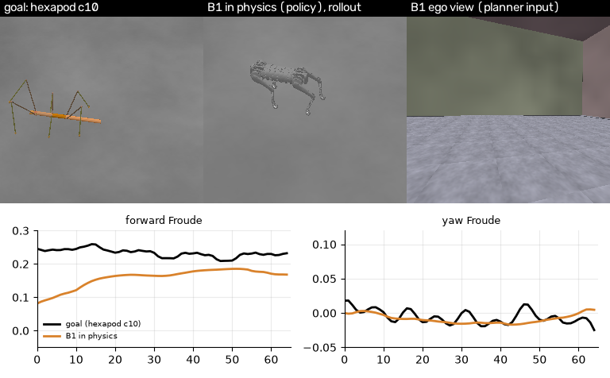

- Motion selection works on all three bodies, to varying degrees; **direct stays as good or better** (rollout loses the
  strong turn on both hexapods).
- The goal does not depend on the scene: **a selector that never looks at the camera does well.** This task cannot show
  what the view, or a predicted view, is worth.

> **Notes.** Direct = scores each command from the command alone (no camera). Rollout = imagines each command's future from
> the current camera view (5 steps x 0.25 s = 1.25 s) and scores the imagined motion. Offline score: 0 = random candidate,
> 1 = best candidate in hindsight; seeds 0 and 1 agree within ~0.03. Physics error E = mean L2 between achieved and goal
> Froude over 33 decisions, one episode per goal (6 held-out hexapod goals), seed 0 only; lower is better. Per-goal table
> in backup. B1 here is in joint pretraining; **B1 as a new body adapted on 2.4 min of clips is running** on the current
> recipe (earlier recipe, F310: rollout +0.70 adapted vs +0.75 joint). Timing: frames 0.05 s (20 Hz), model step 5 frames.

---

## 2. Why the research question expands

- Same goal ("walk forward"), same candidate library, two scenes: on open floor forward is right; facing a wall the same
  command crosses the boundary. **Only the view tells the two situations apart.**
- **Question:** *Can a visual world model predict the consequences of candidate commands so robots with different bodies
  can select motion that fits both a shared goal and the scene?*
- **Wall = a visible virtual boundary.** We measure when the robot's footprint crosses it, not a physical collision.
- Beating blind direct alone would show that **scene information** helps, not necessarily that **prediction** helps.

> **Notes.** The physics has no walls (B1 runs in MuJoCo): the boundary sits at the rendered walls' inner faces. Clearance =
> signed distance from the robot's footprint (rotated rectangle; B1 1.13 x 0.47 m, hexapod 0.82 x 0.46 m) to the boundary;
> per frame SAFE (>= 0.13 body lengths), NEAR (0-0.13) or CROSSED (< 0, last stored frame). The boundary test is the
> scene-dependent test; **it is not yet a demonstrated result**.

---

## 3. Related work: mechanisms

| work | what it learns | how it acts | relation to ours |
|---|---|---|---|
| LAC-WM | latent actions shared across embodiments, frozen V-JEPA2 features; adaptation to new embodiments (manipulation) | world model used for planning / adaptation | our ITM / FTM structure; we add a body-size-free motion goal (Froude) and legged bodies |
| Egocentric VSM | robot self-model from one onboard camera + commands; adapts to a changed body | locomotion from the visual self-model | our view randomisation (grayscale, brightness, blur) |
| QWM | DreamerV3 world model conditioned on a morphology description (from the robot's USD); proprioceptive | actor-critic trained in imagination; zero-shot within the quadruped family | morphology given as input; ours learns from video, each body has its own command projector |
| WMP | recurrent world model (RSSM) on depth + proprioception | PPO policy on simulator data; the world-model state is a policy input | world model as perception; ours compares the predicted futures of a finite candidate library |

**Ours:** shared visual model + **body-specific command projector** + **explicit selection by comparing predicted futures**
of a finite library of recorded commands.

> **Notes.** Checked against the papers: QWM (arXiv 2604.08780) is a DreamerV3 / RSSM model with a physical morphology encoder,
> policy learned in imagination, described by its authors as a distribution-bounded interpolator within quadrupeds. WMP
> (arXiv 2409.16784): "we do not utilize the world model to generate rollout data for policy training"; actor input =
> proprioception + stop-gradient recurrent state. LAC-WM: anonymous ICLR 2026 submission (dexterous manipulation).
> Egocentric VSM: Hu, Chen, Lipson, npj Robotics 2025. We do not claim to be first; QWM and WMP could also be used to
> predict actions -- the difference is how a decision is made, not what is possible.

---

## 4. Two claims, two tests

| claim | evidence needed | status |
|---|---|---|
| **1. Cross-body motion interface** -- c10 trained, c08 zero-shot *within hexapods*, B1 *adapted* with little data; a shared Froude task interface | selection error per body (offline + physics); adaptation data size | measured (slide 1); B1-adapted on the current recipe **running** |
| **2. Predictive visual selection** -- from the same start image, the model tells candidate futures apart and chooses better near a boundary than current-image and direct-risk baselines | prediction check per horizon, then closed loop with crossings **and** progress | **proposed** -- data being finalised |

- Claim 1 is a shared *task interface*, **not** proof that the whole 64-D latent space is aligned across bodies.
- A wall result on **B1 alone** supports a B1 visual-selection claim; the combined cross-body, scene-dependent claim needs a
  wall result on another body (c10; c08 test only).

---

## 5. Why counterfactual wall data

**How the data is collected** (B1, top-down + camera): approach a wall -> back up / step aside -> turn on the spot -> walk
out -> next wall; branch states are saved on the way in.
[video: one collection episode](../results/check/wall_data_pilot/review_escape_var_r10/allocentric/episode_7100_allo.mp4)

**One saved state, six of its 28 commands** (B1, camera + top-down paths): the same start, different outcomes -- some
commands stay clear, some come near, some cross.
[head-on, close to the wall](../results/check/wall_data_pilot/review_escape_var_r10/allocentric/branchgrid_head-on_close_allo.mp4) ·
[in a corner](../results/check/wall_data_pilot/review_escape_var_r10/allocentric/branchgrid_corner_allo.mp4) ·
[back to the wall](../results/check/wall_data_pilot/review_escape_var_r10/allocentric/branchgrid_back_to_wall_allo.mp4)

- Recorded clips show **one** command per state. Branches show **every** candidate from an **identical** state -- including
  the ones that fail.

| | branch | episode |
|---|---|---|
| commands | one of 28, held 3 s (5 s from far states), cut at the crossing | sequence: approach -> back up / side-step -> spin -> walk out |
| use | what each command does from this view | where start states come from; episodes-only ablation |

- The world model learns **consequences** from transitions. A **separate read-out** learns clearance from the labels; the
  selector uses it. **No safety / clearance gradient enters the forward model.**

> **Notes.** 28 commands = the 24 motion commands + 4 turns on the spot (Froude-matched across bodies). Data
> `[measured]`: B1 train / val / test = 35 / 7 / 12 episodes, 157 / 30 / 57 start states; c10 collected and passing the
> exactness gates (every stored episode identical to the run the controller saw), **final balancing running**. Both bodies
> get the same number of start states per distance band x approach (head-on / oblique / corner) x side; approach speed
> matched in Froude. Physics labels train / evaluate the read-out only; they are never an input when the robot decides.

---

## 6. Tests and baselines  `[proposed; protocol locked before any result]`

1. **Offline, frozen model** (held-out start states, 24 common commands):
   - D1: clearance read from **real** future embeddings;
   - D2: the same read-out applied unchanged to **imagined** embeddings;
   - D3: a separate read-out trained on detached imagined embeddings (model frozen).
   - Report per horizon (0.25-1.25 s): command ranking, unsafe detection, error -- by body, distance band, approach type.
2. If needed: retrain the forward model on wall transitions with its **original prediction objectives only**; repeat the
   locked check.
3. **D4** direct action-conditioned risk (*current image + command -> risk*), then **paired closed-loop starts**:

| selector | sees | judges the future by |
|---|---|---|
| blind direct | command only | motion goal only |
| current-image reactive | current frame | read-out on the current frame |
| direct risk (D4) | current frame + command | predicted risk, no imagined view |
| **imagined-future rollout** | current frame + command | read-out on imagined views |
| true-future oracle | true future | true clearance (upper bound) |

Same candidate set and decision interval for all; report **boundary crossings and progress / Froude tracking**.
Audit: the 4 spin commands were outside the earlier projector training.

> **Notes.** Frozen-model D1-D3 is a control: that model has never seen a wall approach, so D3 is expected to fail; the
> retrain gives the before / after with one changed variable (wall data in training). Pass rules (test split, 1.25 s,
> episode bootstrap): D1 real-future ranking > command-only, else stop; D3 > command-only and > copy-current. Wall run uses
> the same steps and schedule as the current model; Froude labels unchanged. Candidates stay the discrete recorded library.

---

## 7. How to read the outcomes (before any result)

| outcome | supports | does not support |
|---|---|---|
| rollout beats blind direct | scene information helps | that prediction helps |
| rollout beats current-image reactive | looking ahead adds value over reacting to the present view | the imagined-view route specifically |
| rollout beats a matched direct action-conditioned risk predictor | the imagined-view route | -- |
| passes on B1 only | a B1 visual-selection claim | cross-body |
| passes on c10 and B1, c08 evaluated as a test body | a stronger cross-body claim | -- |
| prediction fails | the model is not yet accurate enough for this task | any model claim from the oracle result |

---

# Backup

## B1. Pipeline, four separate diagrams  `[to draw]`

| stage | trains | frozen | data | loss |
|---|---|---|---|---|
| (a) pretraining | inverse model (ITM), forward model (FTM), Froude prediction head | V-JEPA2 encoder | clips + branches, c10 (+ B1 in the joint variant) | next-embedding prediction, imagined-read term, Froude head on z |
| (b) new body, stage 1 | ITM / FTM (LoRA rank 8) | encoder, Froude prediction head | 44 clips (2.4 min) of the new body | as pretraining, Froude through the frozen head |
| (c) new body, stage 2 | command projector (command chunk -> z) | everything else | the same clips | z from projector = z from ITM |
| (d) deployment | nothing | everything | camera frame, candidate commands, goal | none: score candidates, pick, replan |

Diagram (d) has **no** future ground truth and **no** physics labels. Remove the Motion Decoder (not used); FTM arrows: (current
embedding, z) -> next embedding.

## B2. Physics, per goal (error to the goal, direct / rollout, seed 0)

| goal | B1 | six-legged | shorter-legged |
|---|---|---|---|
| mild turn | 0.053 / **0.042** | **0.047** / 0.048 | **0.054** / 0.109 |
| strong turn | 0.035 / 0.035 | **0.042** / 0.108 | **0.028** / 0.152 |
| sideways left | **0.014** / 0.027 | 0.029 / **0.028** | 0.037 / 0.037 |
| sideways right | 0.031 / **0.026** | **0.036** / 0.046 | **0.030** / 0.039 |
| speed 7.1 | **0.035** / 0.037 | **0.045** / 0.046 | -- |
| speed 8.8 | **0.058** / 0.098 | 0.100 / **0.073** | 0.095 / **0.073** |

Goal read from the goal video instead of the recorded goal (end-to-end): code done, physics runs **pending**. Offline the
video-read goals are smaller than the recorded ones (strong-turn yaw 0.019 vs 0.063).

## B3. Same state, 24 commands: imagined vs true outcome  `[measured, one state]`

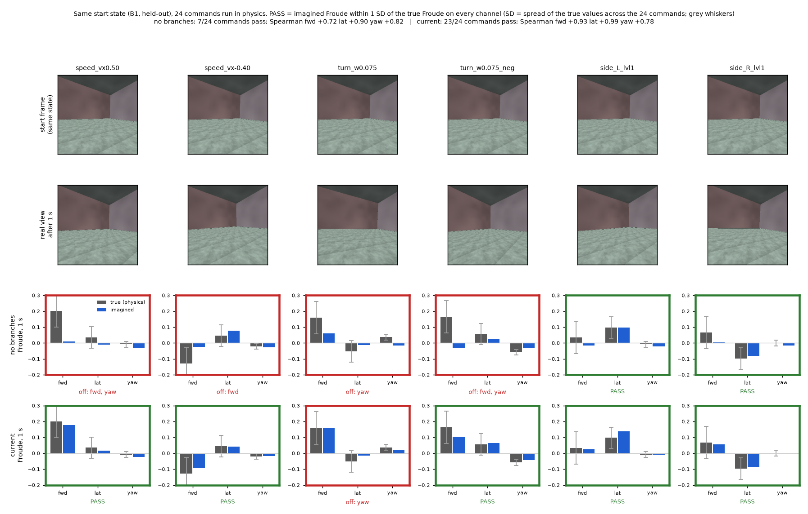

No branches 7 / 24 pass; current model 23 / 24 (fails the strong left turn: imagined yaw too small). One state only.

## B4. Loss before / after adding branches  `[measured, final checkpoints]`

| loss (same evaluation data) | no branches | with branches |
|---|---|---|
| Froude prediction head, held-out branches | 0.97 | **0.54** |
| read-out of z, held-out branches | 0.95 | **0.61** |
| next-embedding prediction | 4.00 | 3.81 |
| total | 9.64 | 8.58 |

Curves over training: step-level logging added; the wall retrain produces them.

## B5. Known weak spots  `[measured]`

- Imagined **yaw** is the weakest channel (about a third of its true size); B1 imagined yaw 0.37 vs 0.42 before grayscale.
- Hexapod **yaw labels** keep gait sway: c10's stride is ~0.55 s, the 1 s label window spans ~1.8 strides -> stride-matched
  labels as a separate experiment.
- z is not one shared space: c10 -> B1 read-out R2 fwd / lat / yaw +0.64 / +0.19 / -0.31 (per-body offset; centring in
  training raises it to +0.69 / +0.45 / +0.18 but does not improve selection).

## B6. Future experiment: recurrent context  `[proposed, not part of the wall run]`

Our model sees one image pair; WMP / QWM carry a recurrent state over time. Test later: the same selector with a short
history (several past frames) vs one image, on the same wall data.
